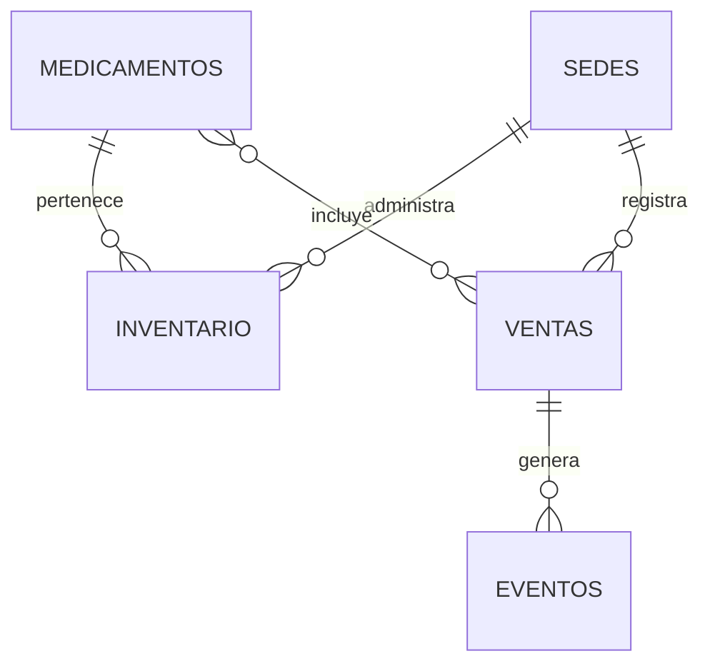

# Modelo de datos - Sistema de Farmacia Distribuida

## 1. Objetivo

Diseñar e implementar una base de datos NoSQL
para gestionar los medicamentos, sucursales,
inventarios, ventas y eventos de una cadena
de farmacias.

La base de datos utiliza MongoDB y se encuentra
distribuida mediante un Replica Set de tres nodos,
permitiendo la replicacion de informacion y
la disponibilidad ante el fallo de un nodo.

## 2. Configuracion

- Motor: MongoDB 8.0.
- Base de datos: farmacia.
- Replica Set: rs0.
- Nodo 1: mongo1:27017.
- Nodo 2: mongo2:27018.
- Nodo 3: mongo3:27019.
- Infraestructura: Docker Compose.

## 3. Modelo conceptual

## 4. Modelo logico

### 4.1 Coleccion medicamentos

Almacena el catalogo de medicamentos.

| Campo | Tipo BSON | Descripcion |
|---|---|---|
| _id | ObjectId | Identificador |
| codigo | String | Codigo unico |
| nombre | String | Nombre del medicamento |
| categoria | String | Categoria |
| precio | Decimal128 | Precio en soles |
| activo | Boolean | Estado del medicamento |

### 4.2 Coleccion sedes

Almacena las sucursales de la farmacia.

| Campo | Tipo BSON | Descripcion |
|---|---|---|
| _id | ObjectId | Identificador |
| codigo | String | Codigo unico |
| nombre | String | Nombre de la sucursal |
| ciudad | String | Ciudad |
| direccion | String | Ubicacion |
| activo | Boolean | Estado de la sede |

### 4.3 Coleccion inventario

Controla las existencias de cada medicamento
en las diferentes sucursales.

| Campo | Tipo BSON | Descripcion |
|---|---|---|
| _id | ObjectId | Identificador |
| medicamento_id | ObjectId | Referencia al medicamento |
| sede_id | ObjectId | Referencia a la sede |
| stock | Int32 | Cantidad disponible |
| stock_minimo | Int32 | Cantidad minima |
| fecha_actualizacion | Date | Ultima modificacion |

### 4.4 Coleccion ventas

Almacena las operaciones de venta.

Modelo propuesto, pendiente de coordinacion
con el integrante de ventas y transacciones.

| Campo | Tipo BSON | Descripcion |
|---|---|---|
| _id | ObjectId | Identificador |
| sede_id | ObjectId | Sucursal de la venta |
| fecha | Date | Fecha de venta |
| detalle | Array | Medicamentos vendidos |
| total | Decimal128 | Importe total |

Cada elemento del detalle puede contener:

- medicamento_id: ObjectId.
- cantidad: Int32.
- precio_unitario: Decimal128.
- subtotal: Decimal128.

### 4.5 Coleccion eventos

Registra acontecimientos del sistema.

Modelo propuesto, pendiente de coordinacion
con los integrantes correspondientes.

| Campo | Tipo BSON | Descripcion |
|---|---|---|
| _id | ObjectId | Identificador |
| tipo | String | Tipo de evento |
| fecha | Date | Fecha del evento |
| venta_id | ObjectId | Referencia opcional |
| descripcion | String | Informacion del evento |

## 5. Relaciones

- Un medicamento puede estar registrado en
  diferentes inventarios.
- Una sede administra varios medicamentos.
- El inventario relaciona medicamentos y sedes.
- Una sede puede registrar varias ventas.
- Una venta puede incluir varios medicamentos.
- Una venta puede generar eventos.

MongoDB utiliza referencias ObjectId y
documentos embebidos en lugar de claves
foraneas tradicionales.

La integridad de las referencias debe
comprobarse mediante la logica de la aplicacion.

## 6. Indices implementados

| Coleccion | Campos | Unico |
|---|---|---|
| medicamentos | codigo | Si |
| medicamentos | nombre | No |
| medicamentos | categoria | No |
| sedes | codigo | Si |
| inventario | medicamento_id, sede_id | Si |
| inventario | sede_id | No |
| ventas | sede_id, fecha | No |
| eventos | fecha | No |
| eventos | tipo | No |

Los indices permiten optimizar consultas
y evitar registros duplicados.

## 7. Validaciones

Se implementaron validaciones mediante
JSON Schema en MongoDB.

### Medicamentos

- Codigo, nombre y categoria obligatorios.
- Precio decimal mayor o igual a cero.
- Estado booleano.

### Sedes

- Codigo, nombre, ciudad y direccion.
- Estado booleano.

### Inventario

- Referencias de tipo ObjectId.
- Stock entero mayor o igual a cero.
- Stock minimo entero mayor o igual a cero.
- Fecha de actualizacion obligatoria.

Las validaciones de ventas y eventos
se definiran durante la integracion.

## 8. Operaciones CRUD

- Create: insertOne().
- Read: find() y findOne().
- Update: updateOne().
- Delete: deleteOne().

Tambien se utilizan consultas de agregacion
con $match, $lookup, $unwind y $project.

## 9. Datos iniciales

- 3 sucursales.
- 10 medicamentos.
- 30 registros de inventario.
- Precios ficticios en soles.

## 10. Resultados de las pruebas

En el entorno local de demostracion:

- 13 pruebas aprobadas.
- 0 pruebas fallidas.
- Rechazo de medicamentos duplicados.
- Rechazo de inventarios duplicados.
- Rechazo de documentos incompletos.
- Rechazo de stock negativo.
- Replicacion comprobada en tres nodos.

Se comprobo la actualizacion de un registro
de inventario de 100 a 120 unidades y su
posterior replicacion en los nodos secundarios.

## 11. Conclusion

La implementacion permite administrar los
datos de una cadena de farmacias mediante
MongoDB, aplicando operaciones CRUD, indices,
validaciones y replicacion distribuida.

El modelo constituye la base para integrar
los modulos de ventas, transacciones,
seguridad, metricas y procesamiento de datos.
